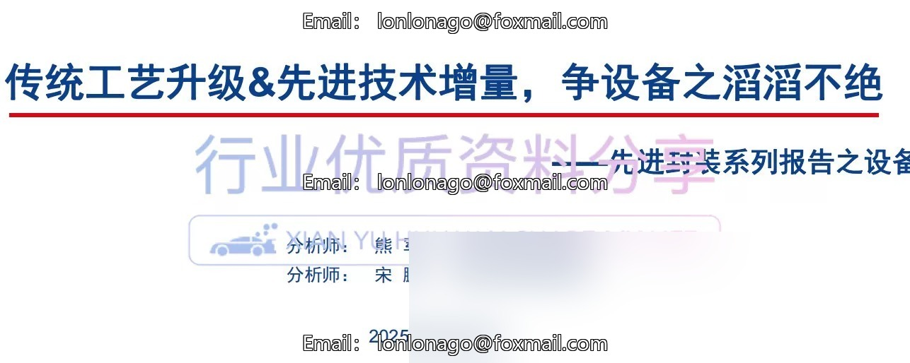
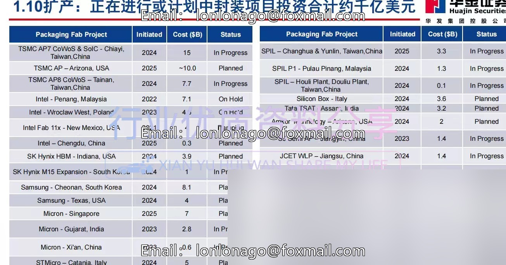
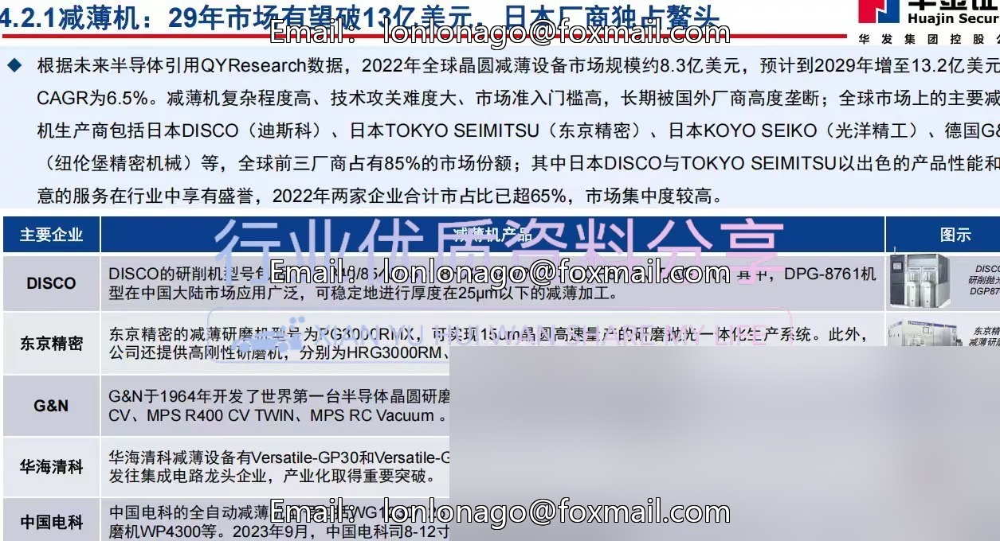
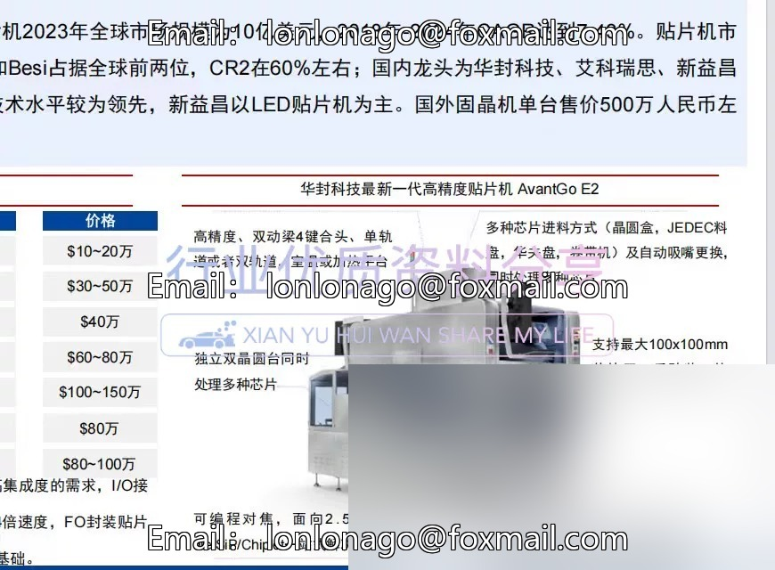

# Advanced packaging equipment latest industry report: 2 documents in total more than 100 pages, with detailed content divided.

## Body

Advancing packaging equipment industry latest report: two documents totaling over 100 pages analyze in detail the entire development trend of advanced semiconductor packaging equipment and equipment technology, as well as the prices of international and domestic equipment manufacturers.

Capture and send the electronic original directly! The following images include screenshots of the file portion. Please confirm before placing the order! Due to the replicable nature of electronic documentation Therefore, are allowed after purchase! Thanks for understanding!

For personal learning and reference use only.

The industry report covers traditional process upgrades and advanced technology gains, analyzing the development trends, equipment technology, and international and domestic equipment vendors and prices.

<!-- AI_ENRICHED -->

## Images

## Payment

Here is a pay link on Stripe ( https://buy.stripe.com/3cs8yP7sY87d0vu9AB ). Please contact me lonlonago@foxmail.com after funding $89, and I will send you a complete data files , thank you!

